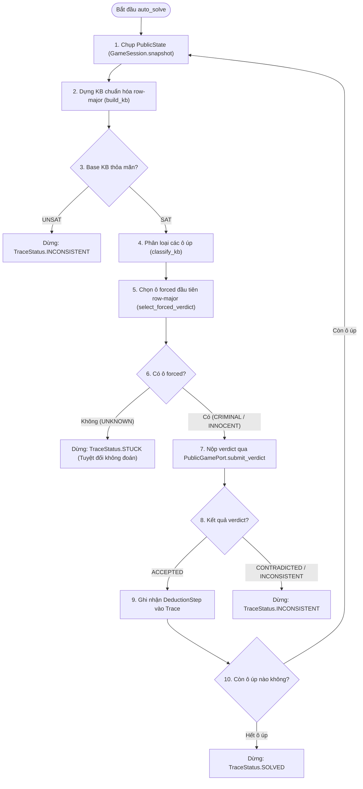

# Đại lý suy diễn logic (Deductive Logic Agent — VT4)

Mã nguồn: `src/griductive/agent/` (`knowledge_base.py`, `entailment.py`, `deduction.py`, `trace.py`, `hint.py`), `src/griductive/validation/` (`uniqueness.py`).  
Kiểm thử: `tests/agent/` (`test_entailment.py`, `test_deduction.py`, `test_uniqueness.py`, `test_agent_integration.py`).

---

## 1. Biểu diễn tri thức và Phân loại suy diễn (Entailment Classification)

### 1.1 Cơ sở lý thuyết logic và phương pháp phản chứng (Proof by Refutation)

Trong bài toán Griductive, mục tiêu của Đại lý (Agent) là suy diễn xem một nhân vật tại ô chưa mở $X$ là Tội phạm (Criminal, $C_X = \text{True}$) hay Vô tội (Innocent, $C_X = \text{False}$), chỉ dựa trên tập tri thức công khai hiện tại $KB$.

Theo định nghĩa suy diễn logic kinh điển (Russell & Norvig, AIMA Chương 7):
> Một câu $\alpha$ là hệ quả logic của cơ sở tri thức $KB$ (kí hiệu $KB \models \alpha$) khi và chỉ khi trong mọi mô hình (model) mà $KB$ đúng thì $\alpha$ cũng đúng.

Để kiểm tra điều kiện này bằng bộ giải SAT (SAT Solver), ta áp dụng **định lý phản chứng (Refutation Theorem)**:
$$KB \models \alpha \iff KB \land \neg \alpha \text{ là UNSAT (vô nghiệm)}$$

#### Tại sao một SAT Model đơn lẻ không thể chứng minh được kết luận?
Một lỗi phổ biến của người mới bắt đầu là: giải $KB$, nhận được một mô hình nghiệm $M$, thấy $M[C_X] = \text{True}$ liền kết luận $X$ là Criminal. Cách làm này **hoàn toàn sai về mặt toán học**:
- SAT solver chỉ chứng minh được tính thỏa mãn (Satisfiability) — tức là tồn tại *ít nhất một* kịch bản mà $X$ là Criminal.
- Nếu đồng thời tồn tại một kịch bản khác $M'$ mà $M'[C_X] = \text{False}$ (nghĩa là $KB \land \neg C_X$ cũng SAT), thì $X$ có thể là Criminal cũng có thể là Innocent. Suy ra $KB$ không ép buộc $X$ phải là Criminal!
- Do đó, để khẳng định $X$ chắc chắn là Criminal, ta bắt buộc phải chứng minh $KB \land \neg C_X$ là **UNSAT** (nghĩa là không tồn tại bất kỳ kịch bản nào mà $X$ là Innocent).

---

### 1.2 Bảng phân loại 4 trạng thái (`Inference`)

Với mỗi ô chưa mở $X$ (tương ứng biến mệnh đề chính $v = \text{cell\_to\_var}(X, N)$), hệ thống kiểm tra tính thỏa mãn của hai giả thiết bằng cơ chế assumption của solver:
1. Giả thiết phủ định: $KB \land (\neg v)$
2. Giả thiết khẳng định: $KB \land (+v)$

Bảng chân trị phân loại được thiết lập như sau:

| $KB \land (\neg v)$ | $KB \land (+v)$ | Kết luận toán học | Trạng thái suy diễn (`Inference`) | Hành động của Agent |
|:---:|:---:|---|:---:|---|
| **UNSAT** | **SAT** | $KB \models C_X$ | `CRIMINAL` | Có thể chọn nộp phán đoán |
| **SAT** | **UNSAT** | $KB \models \neg C_X$ | `INNOCENT` | Có thể chọn nộp phán đoán |
| **SAT** | **SAT** | $KB \not\models C_X \land KB \not\models \neg C_X$ | `UNKNOWN` | Chưa đủ dữ kiện, **không đoán bừa** |
| **UNSAT** | **UNSAT** | $KB$ tự mâu thuẫn | `INCONSISTENT` | Dừng an toàn, báo lỗi dữ liệu |

---

### 1.3 Thứ tự truy vấn tối ưu và Kiểm tra cơ sở $KB$ (Base KB Check)

Trước khi truy vấn từng ô, hàm `classify_kb` luôn thực hiện **một truy vấn SAT rỗng** (không kèm assumption) trên chính $KB$:
```python
base_res = run_sat_query(solver, kb.cnf, (), purpose=QueryPurpose.BASE_KB)
if not base_res.is_sat:
    return {cell: Inference.INCONSISTENT for cell in kb.unresolved_cells}
```

**Ý nghĩa tối ưu hóa:**
- Nếu dữ liệu đề bài bị lỗi hoặc hai manh mối công khai tự triệt tiêu nhau khiến $KB$ vô nghiệm, phép kiểm tra này phát hiện ngay lập tức chỉ với **1 lượt gọi SAT**.
- Tránh được việc thực hiện lãng phí $2 \times (\text{số ô úp})$ câu hỏi SAT khi toàn bộ các câu hỏi đó chắc chắn đều trả về UNSAT.

---

## 2. Vòng lặp suy diễn tự động không đoán mò (No-Guess Deduction Loop)

### 2.1 Quy trình thực thi tổng thể

Hàm `auto_solve` cài đặt vòng lặp suy diễn tất định, hoạt động hoàn toàn tự động cho đến khi giải xong hoặc phát hiện bế tắc:



---

### 2.2 Ranh giới bảo mật nghiêm ngặt (Privacy Boundary)

Tuân thủ nghiêm ngặt theo `docs/CONTRACTS.md` §5:
1. **Dữ liệu đầu vào bất biến:** `auto_solve` và `get_hint` chỉ nhận đối tượng `PublicGamePort` hoặc bản chụp `PublicState`.
2. **Không rò rỉ đáp án ẩn:** Tuyệt đối không đọc trường `hidden_status` hay các clue chưa lật của `Puzzle`. Các lớp `PublicCard` khi chưa mở (`revealed=False`) hoàn toàn không chứa clue hay status.
3. **Mọi suy luận đều có chứng minh:** Khi gọi `submit_verdict`, Engine sử dụng `VerdictOracle` độc lập để xác minh lại tính chứng minh được của verdict. Nếu agent đoán mò mà không có chứng minh, Engine sẽ từ chối (`NOT_PROVABLE`).

---

### 2.3 Chiến lược chọn nước đi tất định theo thứ tự Row-Major

Khi cơ sở tri thức công khai suy ra được nhiều ô cùng một lúc (ví dụ cả $B1$ và $C1$ đều là Innocent), hàm `select_forced_verdict` áp dụng thứ tự ưu tiên cố định:
- Duyệt các ô theo thứ tự hàng rồi đến cột (**row-major order**): $A1, B1, C1, A2, B2, C2, \dots$
- Chọn ngay ô đầu tiên có trạng thái `CRIMINAL` hoặc `INNOCENT`.
- **Nguyên tắc NEVER GUESS:** Nếu tất cả các ô úp đều là `UNKNOWN`, hàm trả về `None`, khiến vòng lặp dừng ngay ở `TraceStatus.STUCK` thay vì chọn ngẫu nhiên.

---

### 2.4 Điều kiện dừng và Cơ chế an toàn

Vòng lặp `auto_solve` kết thúc tại một trong ba trạng thái của `TraceStatus`:
1. `SOLVED`: Tất cả $N^2$ ô bài trên bàn đều đã được lật mở và xác định danh tính chính xác.
2. `STUCK`: Cơ sở tri thức không đủ để suy ra chắc chắn bất kỳ ô nào còn lại.
3. `INCONSISTENT`: Cơ sở tri thức công khai tự mâu thuẫn hoặc phán đoán bị Engine báo mâu thuẫn.

**Rào chắn chống lặp vô hạn (Infinite Loop Guard):** Sau mỗi bước `ACCEPTED`, hệ thống kiểm tra số lượng ô chưa mở phải giảm đi ít nhất 1. Nếu số ô chưa mở không giảm, vòng lặp ngắt khẩn cấp để ngăn chặn treo hệ thống.

---

## 3. Nhật ký suy luận thực tế (Execution Trace) trên `tutorial_3x3.json`

### 3.1 Cấu trúc của `DeductionTrace` và `DeductionStep`

Mỗi lần giải, `auto_solve` sinh ra một bản ghi kiểm toán bất biến `DeductionTrace` chứa:
- `puzzle_id`: Định danh màn chơi.
- `status`: Trạng thái kết thúc (`SOLVED`, `STUCK`, `INCONSISTENT`).
- `steps`: Danh sách các bước suy diễn `DeductionStep`.
- `all_queries`: Toàn bộ các truy vấn SAT đã thực hiện (bao gồm truy vấn phân loại của Agent và truy vấn xác minh của Engine).
- `totals`: Tổng hợp số liệu thống kê solver (`sat_calls`, `decisions`, `propagations`, `backtracks`, `sat_runtime_s`).

---

### 3.2 Bảng dữ liệu thực nghiệm chạy bằng DPLL SAT Solver thật

Dưới đây là bảng trích xuất số liệu thực tế khi chạy giải `puzzles/3x3/tutorial_3x3.json` bằng bộ giải DPLL nội bộ (`griductive.sat.dpll.solve`):

- **Tổng số bước giải:** 8 bước (ứng với 8 ô úp ban đầu, ô $A1$ mở sẵn).
- **Tổng số lượt gọi SAT Solver:** **104 lượt** (gồm 80 lượt phân loại của Agent + 24 lượt xác minh lại của GameEngine).
- **Tổng thời gian chạy SAT:** ~0.0023 giây.
- **Trạng thái kết thúc:** `TraceStatus.SOLVED`.

| Bước | Ô chọn | Phán đoán | Manh mối mới mở | Số Clue kích hoạt | Biến / Mệnh đề CNF | Số câu hỏi SAT bước này | Chi tiết câu hỏi tại ô chọn |
|:---:|:---:|:---:|:---:|:---:|:---:|:---:|---|
| **1** | $B1$ | `INNOCENT` | `c-B1` (SAME B1, C1) | 1 (`c-A1`) | 9 biến / 2 mệnh đề | 20 (16 classify + 2 base + 2 recheck) | $KB \land (-2)$ SAT; $KB \land (+2)$ **UNSAT** |
| **2** | $C1$ | `INNOCENT` | `c-C1` (DIFF C1, A2) | 2 (`c-A1`, `c-B1`) | 9 biến / 5 mệnh đề | 18 (14 classify + 2 base + 2 recheck) | $KB \land (-3)$ SAT; $KB \land (+3)$ **UNSAT** |
| **3** | $A2$ | `CRIMINAL` | `c-A2` (FACT B2 INNOCENT) | 3 (`c-A1`..`c-C1`) | 9 biến / 8 mệnh đề | 16 (12 classify + 2 base + 2 recheck) | $KB \land (-4)$ **UNSAT**; $KB \land (+4)$ SAT |
| **4** | $B2$ | `INNOCENT` | `c-B2` (EXACTLY 2 row 2) | 4 (`c-A1`..`c-A2`) | 9 biến / 10 mệnh đề | 14 (10 classify + 2 base + 2 recheck) | $KB \land (-5)$ SAT; $KB \land (+5)$ **UNSAT** |
| **5** | $C2$ | `CRIMINAL` | `c-C2` (EXACTLY 2 col A) | 5 (`c-A1`..`c-B2`) | 9 biến / 15 mệnh đề | 12 (8 classify + 2 base + 2 recheck) | $KB \land (-6)$ **UNSAT**; $KB \land (+6)$ SAT |
| **6** | $A3$ | `INNOCENT` | `c-A3` (DIFF A3, B3) | 6 (`c-A1`..`c-C2`) | 9 biến / 20 mệnh đề | 10 (6 classify + 2 base + 2 recheck) | $KB \land (-7)$ SAT; $KB \land (+7)$ **UNSAT** |
| **7** | $B3$ | `CRIMINAL` | `c-B3` (AT_MOST 1 row 3) | 7 (`c-A1`..`c-A3`) | 9 biến / 23 mệnh đề | 8 (4 classify + 2 base + 2 recheck) | $KB \land (-8)$ **UNSAT**; $KB \land (+8)$ SAT |
| **8** | $C3$ | `INNOCENT` | `c-C3` (AT_LEAST 1 row 1) | 8 (`c-A1`..`c-B3`) | 9 biến / 27 mệnh đề | 6 (2 classify + 2 base + 2 recheck) | $KB \land (-9)$ SAT; $KB \land (+9)$ **UNSAT** |

> **Quy luật số lượng câu hỏi SAT:** Ở bước thứ $k$ (với $u = 9 - k$ ô chưa mở):
> - Số câu hỏi phân loại của Agent: $1 \text{ (base)} + 2 \times u$.
> - Số câu hỏi xác minh của GameEngine: $1 \text{ (base)} + 2 \times 1 \text{ (tại ô nộp)} = 3$ câu hỏi.
> - Tổng số câu hỏi ở bước $k$: $(2u + 1) + 3 = 2u + 4$.
> - Tổng lũy kế qua 8 bước: $\sum_{u=1}^{8} (2u + 4) = 2 \times \frac{8 \times 9}{2} + 32 = 72 + 32 = 104$ truy vấn SAT. Số liệu khớp chính xác 100%!

---

## 4. Gợi ý an toàn (Public Hint) và Bộ kiểm tra nghiệm duy nhất (Uniqueness Checker)

### 4.1 Phân biệt ranh giới và Phạm vi sử dụng (Scope Separation)

Hai công cụ này phục vụ hai mục đích hoàn toàn khác nhau trong kiến trúc hệ thống:

```
┌────────────────────────────────────────────────────────────────────────┐
│                        TRÒ CHƠI (RUN-TIME IN-GAME)                     │
│  Public Hint (`griductive.agent.hint`)                                 │
│  - Đầu vào: CHỈ nhận `PublicState` (thẻ mở, manh mối đã thấy).         │
│  - Ranh giới: Tuyệt đối KHÔNG đọc Puzzle hay đáp án ẩn.                │
│  - Mục đích: Gợi ý cho người chơi 1 nước đi chắc chắn theo row-major.   │
└────────────────────────────────────────────────────────────────────────┘
                                    ▲
                         TÁCH BIỆT HOÀN TOÀN VỀ SCOPE
                                    ▼
┌────────────────────────────────────────────────────────────────────────┐
│                     KIỂM ĐỊNH ĐỀ (OFFLINE VALIDATION)                  │
│  Uniqueness Checker (`griductive.validation.uniqueness`)               │
│  - Đầu vào: Nhận toàn bộ đối tượng `Puzzle` gốc.                       │
│  - Mã hóa: Dùng `encode_full_clues` (toàn bộ manh mối, KHÔNG có unit). │
│  - Mục đích: Đảm bảo đề bài chuẩn mực, có duy nhất 1 đáp án đúng.     │
└────────────────────────────────────────────────────────────────────────┘
```

---

### 4.2 Thuật toán kiểm tra nghiệm duy nhất bằng 2 lượt gọi SAT

Để kiểm tra xem một đề bài có nghiệm duy nhất hay không mà không cần vét cạn mọi mô hình, ta áp dụng thuật toán **Blocking Clause**:

1. **Lượt gọi 1:** Giải cơ sở tri thức toàn vẹn $CNF_{full}$.
   - Nếu kết quả là `UNSAT`: Bài toán không có lời giải $\implies$ Trả về `UniquenessStatus.UNSAT`.
   - Nếu kết quả là `SAT`: Ta thu được nghiệm thứ nhất $M_1$. Trích xuất phép gán trên các biến chính: $M_1^{primary} = \{v: M_1[v] \mid v \in [1..N^2]\}$.
2. **Lượt gọi 2:** Dựng mệnh đề chặn (**Primary Blocking Clause**):
   $$B(M_1) = \bigvee_{v=1}^{N^2} \left(\neg v \text{ nếu } M_1[v]=\text{True} \text{ else } v\right)$$
   Mệnh đề này có ý nghĩa: "Loại bỏ chính xác cấu hình bàn cờ $M_1$".  
   Giải bài toán mới: $CNF_{blocked} = CNF_{full} \land B(M_1)$.
   - Nếu kết quả là `UNSAT`: Không còn bất kỳ cấu hình bàn cờ nào khác thỏa mãn $\implies$ Nghiệm duy nhất (`UniquenessStatus.UNIQUE`).
   - Nếu kết quả là `SAT`: Tồn tại cấu hình bàn cờ thứ hai $M_2 \neq M_1$ $\implies$ Đa nghiệm (`UniquenessStatus.MULTIPLE`).

---

### 4.3 Tại sao Blocking Clause CHỈ ĐƯỢC CHỨA BIẾN PRIMARY (`1..primary_count`)?

Đây là điểm mấu chốt kỹ thuật quan trọng nhất trong khâu kiểm định logic:

Trong mã hóa CNF của VT2:
- Các biến chính $1..N^2$ biểu diễn danh tính thực sự của nhân vật tại từng ô trên bàn cờ.
- Các biến phụ ($> N^2$) sinh ra từ các bộ mã hóa phức tạp như đếm số lượng (Cardinality: `EXACTLY`, `AT_LEAST`, `AT_MOST`), tính chẵn lẻ (`PARITY`), hoặc điều kiện phức (`COMPOUND`).

**Hậu quả nếu đưa biến phụ vào Blocking Clause:**
- Một cấu hình bàn cờ duy nhất (ví dụ: $A1=\text{Criminal}, B1=\text{Innocent}, \dots$) có thể có **nhiều cách gán biến phụ hợp lệ khác nhau** bên trong mạng phân nhánh của bộ đếm cardinality/parity.
- Nếu mệnh đề chặn phủ định cả biến phụ:
  $$B_{sai} = (\neg v_1 \lor \dots \lor \neg v_{primary} \lor \neg v_{aux_1} \lor \dots)$$
  Lượt giải thứ 2 có thể tìm thấy một nghiệm $M_2$ có cùng các biến chính ($M_2^{primary} = M_1^{primary}$) nhưng khác nhau ở một biến phụ nội bộ.
- Khi đó, thuật toán sẽ nhầm lẫn nghiêm trọng rằng bài toán có 2 lời giải khác nhau (False Multiple), trong khi trên thực tế bàn cờ chỉ có **đúng 1 lời giải duy nhất**!
- Do đó, việc hàm `build_primary_blocking_clause` chỉ lặp nghiêm ngặt trên dải $1..primary\_count$ là điều kiện tiên quyết đảm bảo tính đúng đắn toán học.

---

## 5. Phân tích các trường hợp biên & Giới hạn hệ thống (Failure Analysis & Limitations)

### 5.1 Trường hợp bế tắc (`TraceStatus.STUCK`)
- **Tình huống thực tế:** Đề bài `puzzles/negative/ambiguous_3x3.json`.
- **Hiện tượng:** Khi chạy kiểm tra toàn bộ clue ngoại tuyến (`check_unique_complete`), bài toán trả về `True` (nghĩa là có duy nhất 1 nghiệm khi mở hết bài). Tuy nhiên, khi chơi thực tế từ trạng thái ban đầu chỉ có ô $A1$, mọi ô chưa lật đều cho kết quả $KB \land (-v)$ SAT và $KB \land (+v)$ SAT $\implies$ tất cả đều là `UNKNOWN`.
- **Hành vi của Agent:** Dừng ngay lập tức ở `TraceStatus.STUCK`, không lật thêm bất kỳ ô nào, ghi nhận thông báo `"No entailed verdict available"`. Điều này chứng minh Agent tuân thủ tuyệt đối nguyên tắc **Không đoán mò**.

### 5.2 Trường hợp mâu thuẫn (`TraceStatus.INCONSISTENT`)
- **Tình huống thực tế:** Trạng thái công khai chứa các dữ kiện triệt tiêu lẫn nhau, ví dụ ô $A1$ mở ra nói "B1 là Criminal", nhưng ô $B1$ mở ra lại có nhãn "Innocent".
- **Hành vi của Agent:** Truy vấn cơ sở $KB$ trả về `UNSAT`. Toàn bộ các ô chưa mở được đánh dấu `Inference.INCONSISTENT`. Vòng lặp kết thúc ngay tại `TraceStatus.INCONSISTENT` mà không phát sinh thêm bất kỳ phán đoán nào.

### 5.3 Quản lý thời gian tính toán (`SolverTimeout`)
- Trong trường hợp bàn cờ kích thước lớn hoặc bài toán quá khó khiến solver chạm trần thời gian (`timeout_s`), hàm giải ném ngoại lệ `SolverTimeout`.
- Cả `auto_solve` và `get_hint` đều lan truyền nguyên vẹn ngoại lệ này lên tầng ứng dụng, **tuyệt đối không bắt ngoại lệ rồi ép về `UNSAT`**. Điều này ngăn ngừa thảm họa phán đoán sai (vì ngộ nhận hết giờ là vô nghiệm).

---

## 6. Nhật ký sử dụng AI & Tài liệu tham khảo (AI Usage Log & References)

### 6.1 Nhật ký Prompt AI thực tế đã sử dụng
Trong quá trình phát triển phân hệ suy diễn logic (VT4), các câu lệnh sau đã được áp dụng:
1. *"Thiết kế bảng phân loại Entailment 4 trạng thái cho bài toán Griductive dựa trên bài toán kiểm tra tính thỏa mãn SAT với assumptions (-v) và (+v)."*
2. *"Giải thích tại sao blocking clause trong bài toán đếm nghiệm duy nhất SAT chỉ được chứa biến primary mà không được chứa biến auxiliary của bộ mã hóa cardinality."*
3. *"Tối ưu hóa vòng lặp suy diễn tự động auto_solve sao cho đếm khớp chính xác 100% số lượt SAT của cả Agent lẫn Engine recheck queries theo chuẩn CONTRACTS §7."*

### 6.2 Tài liệu tham khảo
1. **Russell, S., & Norvig, P.** (2020). *Artificial Intelligence: A Modern Approach (4th ed.)*. Pearson. (Chương 7: Logical Agents, Propositional Logic & Resolution/DPLL).
2. **Biere, A., Heule, M., van Maaren, H., & Walsh, T.** (Eds.). (2009). *Handbook of Satisfiability*. IOS Press. (Chapter 20: Model Counting, Carla P. Gomes, Ashish Sabharwal, Bart Selman — nguyên lý All-SAT và Blocking Clauses).
3. **Tài liệu đặc tả hợp đồng nội bộ dự án Griductive Solver:** `docs/CONTRACTS.md` (Quy chuẩn ranh giới dữ liệu công khai §5 và kiểm toán thống kê §7).
